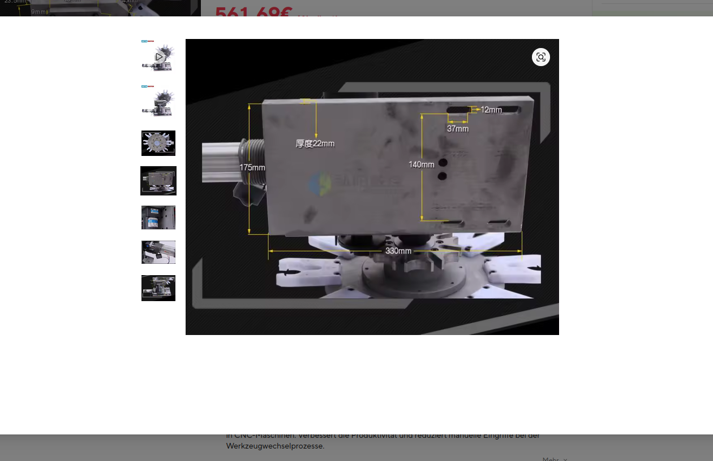
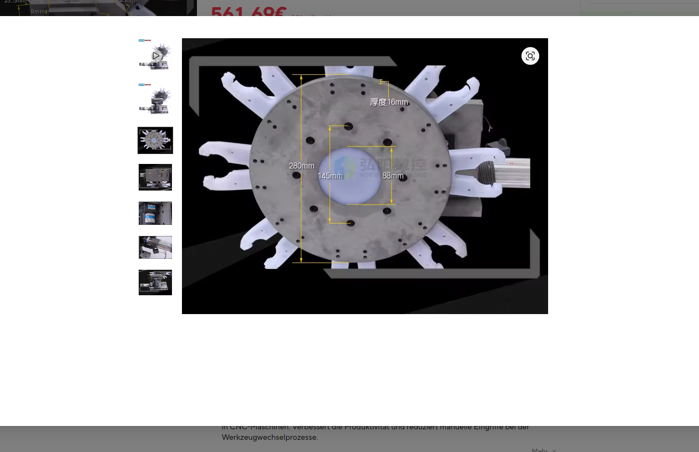
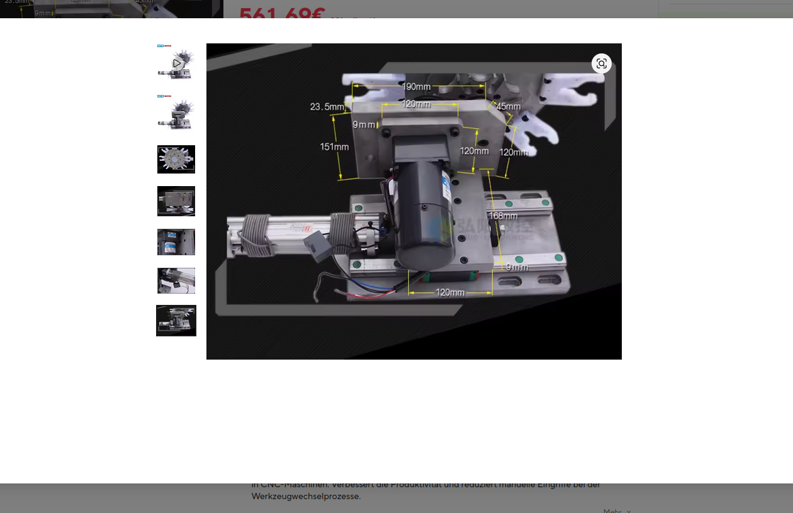

# Gewaehlter RATTM-Werkzeugwechsler: Bildauswertung und Einbau

**Fortschreibung01.11.2026:** Nutzer bestaetigt die gewaehlte Angebotsvariante
als **BT30**. Die Auswahl ist damit geklaert. Bildzuordnung zur konkreten
Lieferausfuehrung und Passung an OriginalSK30/DIN2080/M12 bleiben unbestaetigt.

Stand01.11.2026; Ausgangsrevision2b83f2c. Belege sind sechs vom Nutzer gelieferte
Screenshots zum [AliExpress-Artikel1005009887984460](https://de.aliexpress.com/item/1005009887984460.html).
Das sichtbare Logo lautet RATTM MOTOR. Nutzerentscheidung: diesen Wechsler
vorerst verwenden; direkte Befestigung an der Fraese ist erlaubt. Parkseite
bleibt rechts neben dem Kopf. Der Tisch bleibt frei.

Die Bildkopien sind unveraendert im Git-Repository gesichert:
[Provenienz mit SHA256](../../referenzen/kaufteile/rattm_1005009887984460/provenienz.json).
Die Zuordnung zum Artikel stammt vom Nutzer. Keine bekannte Zeichnungsrevision,
keine Toleranzen und keine lieferantenseitig bestaetigte Zeichnungszuordnung. Die folgenden Zahlen sind
abgelesene Lieferantenbildangaben, keine Istmessung an der Maschine oder am Produkt.

## Ablesbare Angaben

| Bauteil / Angabe | Wert | Quelle und Grenze |
|---|---:|---|
| Grundplatte |330 x175 x22mm|Bild4; Dicke als22mm beschriftet|
| Langlochbreite |12mm|Bild4|
| Laengenangabe am Langloch |37mm|Bild4; Gesamtlaenge vs. Radienabstand unklar|
| Abstand Langlochreihen |140mm|Bild4; horizontaler Lochabstand/Randbezuege fehlen|
| Metallscheibe |Durchmesser280mm, Dicke16mm|Bild5; ohne vorstehende Greifer|
| Zentrale Massspanne |88mm|Bild5; genaue Funktion/Passung nicht belegt|
| Vertikaler Schraubpunktabstand |145mm|Bild5; nicht als Lochkreis verwenden|
| Werkzeuggabeln |8 sichtbar|Bild5/6; Greiferprofil, Retention und Bildzuordnung zur BT30-Ausfuehrung offen|
| Oberer Traeger / Schlitten |190,120,151,23.5,9,45,120,120,168,120,9mm|Bild1; getrennte Beschriftungen, Bezugssicherheit begrenzt|
| Pneumatikzylinder |BAIDI SU32X200-S|Bild2;32mm Bohrung/200mm Hub nur Typcode-Arbeitshypothese|
| Magazinmotor |ZD4RK25GN-CM, BRAKE MOTOR|Bild3|
| Motortypenschild |25W;220V;0.28A;50Hz;1300rpm;30min;2.2uF|Bild3; abgelesene Werte, keine Schaltungsfreigabe|
| Getriebekopf |4GN25K|Bild3; genaue Uebersetzung/Indexierfunktion separat bestaetigen|

Alle21 Laengenangaben mit einzelnen Belegzuordnungen stehen in
[Produktdaten_RATTM_1005009887984460.json](Produktdaten_RATTM_1005009887984460.json).
Der im Hintergrund der Screenshots sichtbare Preis ist kein bestaetigter
Varianten-/Lieferpreis. Das Paket ist ausgewaehlt, nicht bestellt.

## Massbilder

Grundplatte:

Tellerscheibe:

Traeger und Schlitten:

Weitere Belege: [Zylinder](../../referenzen/kaufteile/rattm_1005009887984460/02_zylinder.png),
[Motor/Getriebe](../../referenzen/kaufteile/rattm_1005009887984460/03_motor_getriebe.png),
[Gesamtansicht](../../referenzen/kaufteile/rattm_1005009887984460/06_gesamtansicht.png).

## Abgleich mit vorhandenem CAD11

| Merkmal | Bisheriger Eigenentwurf11 | Gewaehltes Produkt |
|---|---:|---|
| Scheibe |310mm Durchmesser,10mm dick|280mm Durchmesser,16mm dick laut Bild|
| Werkzeugteilkreis |Radius180mm als Entwurf|Nicht bemasst;280mm Scheibe ist kein Teilkreis|
| Zustellweg |389.33296255086793mm|200mm aus Zylindertyp vermutet; nutzbarer Weg offen|
| Befestigung |Stuetzung am rechten Einhausungsgestell|Direkt an Fraese erlaubt; Anschluss noch auszulegen|
| Werkzeugaufnahme |BT30-Huellen bei unveraenderterSK30/M12-Spindel|BT30 vom Nutzer bestaetigt; Spindelpassung offen|

Die Modellwerte sind aus `teller10.py` und `Layout_Parameter_11.json` abgeleitet.
Gegenueber hypothetischen200mm fehlen der bisherigen Anordnung189.33mm Weg.
Das ist ein Vergleich der Nennwerte, kein Nachweis einer realen Reichweite.
Die neue Parkposition muss mit tatsaechlichem Greiferteilkreis und Schlittenbezug
neu bestimmt werden. Die alte389mm-Zustellung wird nicht als Produkteigenschaft
weitergefuehrt. Die vorhandenen nativen Dateien bleiben als bisheriger
Eigenentwurf erhalten; in diesem Belegpaket wurden keine neuen Parts erzeugt.

## Befestigung und Wechselprinzip

Vorzugsentwurf des Bearbeiters: Konsole an einer geeigneten **feststehenden
Anschlussflaeche der Saeule rechts vom Kopf**. Der Magazin-Schlitten fuehrt
einen Greifer zur Spindel; die CNC-Z-Achse erzeugt die vertikale Relativbewegung
fuer Entnahme/Einsetzen. Tragfaehigkeit, genaue Konsolenform und Anschlussflaeche
sind damit noch nicht festgelegt. Das Werkzeugmagazin muss gegen Spaene/KSS
geschuetzt sein, der beidseitige Spaenefang bleibt bestehen.

Alternative Gestellkonsole: entkoppelt die Befestigung vom Maschinenguss,
braucht aber einen steifen, ausrichtbaren Anschluss und eine erneute Lagepruefung.
Mitfahrende Kopfmontage: haelt die Hoehenlage zum Kopf konstant, erzeugt damit
allein aber keine vertikale Relativbewegung zwischen festgehaltenem Werkzeug
und Spindel. Dafuer waere eine gesondert nachgewiesene Relativachse/Pinolenbewegung
erforderlich. Eine solche Bewegung ist aktuell nicht Teil des ATC-Konzepts.

Die Fotografierichtung legt nicht sicher die erlaubte Betriebsorientierung
fest. Ebenso fehlen Masse, Schwerpunkt und zulaessige Werkzeuglast. Deshalb
noch keine Bohrungen, Gewinde oder Freistellungen am Maschinenguss festlegen.

## Einkauf, Mengen und Spannpaket

Die vorhandene Position **O10-TELLER, Menge1Paket** fuehrt jetzt den gewaehlten
Artikel. Die enthaltenen CAD-Koerper sind weiterhin Eigenentwurf11, entsprechend
im Katalog und in der Einkaufsliste gekennzeichnet. Kein zusaetzliches zweites
Magazin, keine einzelnen8 kompletten Pakete. Lieferumfang von Greifern, Sensoren,
Ventil und Ansteuerung offen. Die vorhandenen8BT30-Werkzeughalter sind weiterhin
Planungsreferenzen; ihre Eignung fuer diese Variante ist nicht bestaetigt.

Der Zylinder im Bild dient der Magazinzustellung. Er ersetzt kein ausgelegtes
Spindelspannpaket. SK30/DIN2080/M12 wird nicht durch Magazinwahl zuBT30-ATC.
Automatische Spannung, Loesung, Retention, Orientierung, passende Anzugsbolzen
und Fehlerverhalten bleiben eigene Entwicklungsaufgaben.

## Noch notwendige Angaben und Nachweise

- Lieferantenzeichnung der bestaetigten BT30-Variante; Greiferzeichnung einschliesslich
  Haltekraft, Oeffnung und passendem Werkzeughalter.
- Werkzeug-Teilkreis, aeussere Greifer-/Werkzeughuelle, Tellerachse und
  Aufnahmehoehe bezogen auf Grundplatte/Schlitten; nutzbarer Hub und Endlagen.
- Erlaubte Betriebsorientierung, Gewicht, Schwerpunkt, Lastgrenzen, Sensorik,
  Verriegelung und tatsaechlicher Lieferumfang.
- Istaufmass an der rechten Saeule und am Kopf; Fuehrungs-/Gussrippen/Wandstaerke,
  Kopf- und Tischbewegung, Werkzeuglaengen, Spannmittel und Wartungszugang.
- Neues parametrisches Produktmodell, Befestigung und volle Wechselbahn; danach
  getrennte native NX2406-Erzeugung und Wiedereroeffnung in neuen Laufordnern.

`build_ready`, `purchase_released`, `machine_operation_enabled` und
`atc_operational` bleiben false. Keine neue native Ausfuehrung oder reale
Maschinenpassung wird durch diese Bildauswertung behauptet.

Arbeitsplan: [RATTM-Bildmasse](../../docs/superpowers/plans/2026-11-01-rattm-bildmasse.md).
Pruefprotokoll: [Belegfortschreibung](../../ergebnisse/entwicklung/20261101_rattm_bildmasse/README.md).
